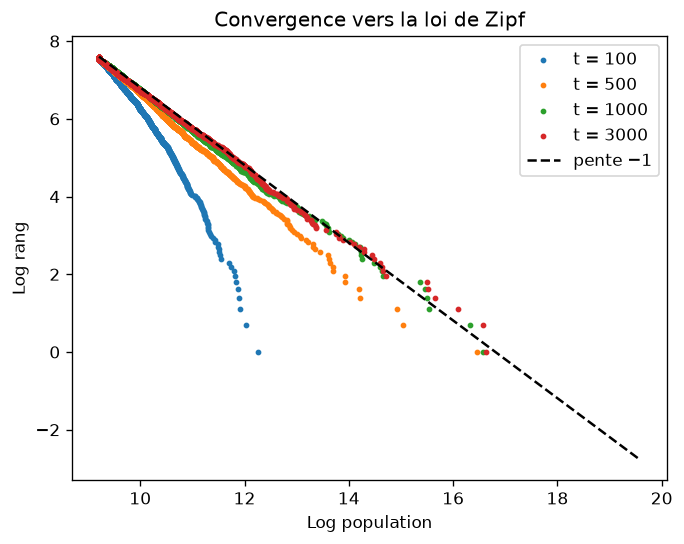

# zipf-villes

Analyses statistiques de la **loi de Zipf** sur les populations de villes : estimation de l'exposant par régression et par maximum de vraisemblance, comparaison avec la loi log-normale, et simulation d'un processus de croissance qui produit la loi.

La loi de Zipf dit que la ville de rang r a une population proportionnelle à 1/r (exposant ζ = 1). On l'étudie ici sur les communes françaises, les aires d'attraction des villes (Insee) et les aires métropolitaines américaines (US Census Bureau).

## Ce que montre le projet

- **L'estimation de l'exposant dépend de la méthode et du nombre de villes retenues.** La régression du log-rang sur le log-taille, la plus courante, est biaisée en petit échantillon, et les écarts-types qu'elle affiche sont faux (les résidus sont très fortement autocorrélés). Le projet compare la régression classique, sa correction de Gabaix et Ibragimov (régression de log(rang − 1/2)), et le maximum de vraisemblance avec choix du seuil par Kolmogorov-Smirnov.
- **Zipf ou log-normale ?** Un test de Vuong compare la loi de Pareto à la loi log-normale tronquée. Sur la queue d'une distribution, une log-normale très étalée imite une loi de puissance : le test dit si les données permettent de trancher.
- **D'où vient la loi de Zipf ?** Une croissance proportionnelle de moyenne nulle, avec une taille minimale, donne exactement ζ = 1 (Gabaix, 1999). Mais la convergence est lente : avec σ = 0,1 elle demande environ mille périodes.



Dans la simulation, les mêmes 2 000 villes après 100, 500, 1 000 et 3 000 périodes : la queue de la distribution ne rejoint la droite de pente −1 qu'après plusieurs centaines de périodes.

## Contenu du dépôt

| Chemin | Rôle |
|---|---|
| `src/zipf_villes/data.py` | téléchargement et préparation des trois jeux de données |
| `src/zipf_villes/estimation.py` | régression, maximum de vraisemblance, choix du seuil, comparaison à la log-normale |
| `src/zipf_villes/simulation.py` | simulation du processus de croissance, exposant théorique |
| `notebooks/donnees.ipynb` | les données et leur préparation |
| `notebooks/regressions.ipynb` | estimation par régression et ses limites |
| `notebooks/maximum_vraisemblance.ipynb` | maximum de vraisemblance, Zipf contre log-normale |
| `notebooks/simulation.ipynb` | le processus de croissance, la convergence |
| `tests/` | tests (aucun accès réseau) |
| `images/` | figures produites par les notebooks |

## Installation

Avec [uv](https://docs.astral.sh/uv/) :

```bash
uv sync
uv run pytest
uv run ruff check
uv run ruff format
```

Les notebooks s'ouvrent depuis le dossier `notebooks/` (les chemins vers `data/` et `images/` sont relatifs), avec l'environnement `.venv` créé par `uv sync`.

Les notebooks `donnees`, `regressions` et `maximum_vraisemblance` téléchargent les fichiers de l'Insee et du Census au premier lancement (dans `data/`, ignoré par git) : ils sont livrés sans résultats et se régénèrent à l'exécution, y compris les figures de `images/`. Le notebook `simulation` n'a besoin d'aucune donnée.

## Utilisation

```python
from zipf_villes import (
    ajuste_mco,
    ajuste_pareto,
    charge_populations,
    compare_lognormale,
)

com_pop, aav, msa = charge_populations("data")

ajuste_mco(com_pop["PTOT"], n=100, decalage=0.5)  # régression de Gabaix-Ibragimov
pareto = ajuste_pareto(com_pop["PTOT"])  # maximum de vraisemblance, seuil choisi
compare_lognormale(com_pop["PTOT"], pareto.xmin)  # Zipf contre log-normale
```

Les estimateurs de `estimation.py` ont été vérifiés contre `statsmodels` (régression) et le package [powerlaw](https://github.com/jeffalstott/powerlaw) (maximum de vraisemblance et test de Vuong) : voir `tests/test_estimation.py`.

## Sources et références

Données :

- Insee, [population en 2020](https://www.insee.fr/fr/statistiques/6683035?sommaire=6683037) (communes) et [zonage en aires d'attraction des villes 2020](https://www.insee.fr/fr/information/4803954). Les conditions de réutilisation sont indiquées sur la page de chaque jeu de données.
- US Census Bureau, [estimations de population 2021 des aires métropolitaines](https://www.census.gov/data/tables/time-series/demo/popest/2020s-total-metro-and-micro-statistical-areas.html).

Références :

- Gabaix (1999), *Zipf's law for cities: an explanation*, Quarterly Journal of Economics.
- Gabaix et Ibragimov (2011), *Rank − 1/2: a simple way to improve the OLS estimation of tail exponents*, Journal of Business & Economic Statistics.
- Clauset, Shalizi et Newman (2009), *Power-law distributions in empirical data*, SIAM Review.
- Eeckhout (2004), *Gibrat's law for (all) cities*, American Economic Review.
- Clémentine Cottineau, [MetaZipf](https://github.com/ClementineCttn/MetaZipf) : méta-analyse d'estimations de l'exposant de Zipf pour les villes.

## Licence

Le code de ce dépôt est distribué sous licence MIT (fichier `LICENSE`).
